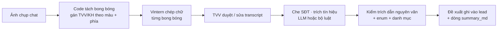

# AutoLead · MVP đọc ảnh chụp đoạn chat Zalo / Messenger

> Báo cáo đầy đủ (luồng, kiến trúc, số đo, câu hỏi mở): [`docs/research/2026-10-06-chat-screenshot-ocr-mvp.md`](https://github.com/AI20K-Build-Phase-Cohort-4/P-102/blob/develop/docs/research/2026-10-06-chat-screenshot-ocr-mvp.md) trong repo dự án AutoLead (P-102).

Thử nghiệm độc lập (ngoài repo P-102) cho ý tưởng: tư vấn viên (TVV) chụp màn hình đoạn chat với khách
trên Zalo / Messenger → hệ thống đọc ảnh → lấy ra **transcript có người nói** và **tín hiệu bán hàng**
(mẫu xe, tài chính, người cùng quyết định, thời điểm mua, mốc lái thử / đặt cọc / từ chối) theo đúng bộ
trường của AutoLead. Mọi đoạn chat là **tự dựng**, không có khách thật.

## Luồng



Chia vai có chủ đích:

- **Code** làm phần chắc chắn được: tách bong bóng và gán người nói theo màu nền và phía của bong bóng.
  Model 1B hay nhầm trái/phải, mà nhầm người nói là đảo nghĩa câu.
- **Vintern (1B)** chỉ *chép chữ*. Phần ngôn ngữ của nó là Qwen2-0.5B, quá nhỏ để hiểu ý định.
- **LLM lớn** (FPT `gpt-oss-120b` như dự án) *hiểu ngữ nghĩa*, kèm bộ luật offline để chạy khi không có key.
- **Bước kiểm bằng code** giống `claims.py` của dự án: tín hiệu nào thiếu trích dẫn nguyên văn, sai enum
  hoặc sai danh mục mẫu xe thì bị bỏ.

## Cài và chạy

```bat
run.bat
```

Lần đầu, `run.bat` tạo `.venv` (Python 3.13) và cài `requirements.txt`, sau đó mở <http://127.0.0.1:7860>.

Cài tay (PowerShell):

```powershell
py -3.13 -m venv .venv
.venv\Scripts\python -m pip install -r requirements.txt
.venv\Scripts\python app.py
```

### Tải model Vintern

```powershell
.venv\Scripts\python download_models.py          # Vintern-1B-v3.5, khoảng 3,8 GB
.venv\Scripts\python download_models.py --v2     # thêm Vintern-1B-v2, khoảng 1,9 GB
```

Lệnh này cần mạng vào được `huggingface.co`. Nếu máy không tải được, tải tay toàn bộ file của
[5CD-AI/Vintern-1B-v3_5](https://huggingface.co/5CD-AI/Vintern-1B-v3_5/tree/main) (trừ `README.md`), gồm
`model.safetensors`, các file `*.py`, `*.json` và `merges.txt`, rồi đặt vào `models/Vintern-1B-v3_5/`.
App tự dùng thư mục này nếu có. Bản v2 tương tự, đặt vào `models/Vintern-1B-v2/`.

### Backend nhanh: llama.cpp + Vintern GGUF (khuyên dùng)

```powershell
.venv\Scripts\python setup_llama.py
```

Script tải llama.cpp `b11433` (bản Vulkan và bản CPU) từ GitHub, rồi chuyển bản Vintern gốc sang GGUF Q8 ngay
trên máy (khoảng 30 giây). Kết quả nằm ở `models/Vintern-1B-v3_5-GGUF/`. App tự bật `llama-server` khi bạn
chọn backend **Vintern-1B-v3.5 GGUF · llama.cpp**. Vulkan chạy được trên GPU Intel Arc, AMD hoặc NVIDIA. Để
ép chạy CPU, đặt `LLAMA_BACKEND=cpu` trong `.env`. Log của server ghi vào `logs/llama-server.log`.

Hai lỗi đã gặp khi chuyển đổi, script đã tự xử lý:

- Bản chuyển đổi **thiếu `eos_token_id`**, nên llama.cpp lấy mặc định token 11, tức dấu ",". Hậu quả là mọi
  câu bị cắt ngay sau dấu phẩy đầu tiên. Script gán lại `eos`/`eot` = `<|im_end|>` (151645).
- Thiếu **system prompt của Vintern** (template Hermes-2) thì model trả lời lệch. `vlm.py` gửi kèm prompt này.

### Tốc độ đo được (6 ảnh mẫu, tách bong bóng, Intel Core Ultra 7 155H + Arc iGPU)

| Backend | Giây/ảnh | CER | Đúng người nói | Đúng trường |
|---|---|---|---|---|
| Vintern-1B-v3.5 · PyTorch CPU float32 | 52,6 | 0,2% | 100% | 100% |
| **Vintern-1B-v3.5 GGUF Q8 · llama.cpp Vulkan (GPU Arc)** | **13–14** (lần đầu sau khi bật thêm khoảng 5 giây) | **0%** | **100%** | **100%** |
| Vintern GGUF · llama.cpp CPU | khoảng 50 | — | — | — |

Đã thử thêm nhưng **không áp dụng**:

- Chạy song song 1, 2 hay 4 luồng, hoặc bật flash attention: lệch nhau dưới 10%, vì GPU tích hợp đã chạy hết
  công suất.
- Bản F16 thay Q8: chậm hơn, chữ đọc ra giống hệt.
- Ghép 3–5 bong bóng vào một ảnh có đánh số: nhanh thêm 20–40%, nhưng có ô bị trả rỗng và có chỗ bịa thêm
  giờ. Không đáng đánh đổi.

Muốn dưới khoảng 5 giây mỗi ảnh thì cần GPU rời, hoặc gọi VLM trên cloud (mục dưới).

### Qwen3-VL qua Hugging Face (cloud)

Backend **HF · Qwen3-VL-30B-A3B-Instruct** gọi `router.huggingface.co`, gửi mỗi bong bóng một request,
tối đa 8 request song song. Model này đang có các nhà cung cấp novita, deepinfra và featherless-ai.

1. Tạo token ở <https://huggingface.co/settings/tokens>, chọn loại *Fine-grained* và tick
   **Make calls to Inference Providers**.
2. Ghi vào `.env`: `HF_TOKEN=hf_...`. Đổi model bằng `HF_VLM_MODEL`, ví dụ `Qwen/Qwen3-VL-8B-Instruct`.

Lưu ý: cách này **gửi ảnh ra ngoài**, nên chỉ dùng với ảnh tự dựng. Nhánh này chưa đo được tốc độ, vì token
Hugging Face trên máy dựng MVP đã hết hạn (router trả 401).

### Cấu hình tuỳ chọn (`.env`)

Sao chép `.env.example` thành `.env`.

- `LLM_API_KEY` cùng `LLM_BASE_URL` / `LLM_MODEL`: trích tín hiệu bằng LLM. Mặc định là FPT
  `gpt-oss-120b`; tự điền key của bạn vào.
- `HF_TOKEN`, `HF_VLM_MODEL`: dùng Qwen-VL qua Hugging Face (mục trên).
- `LLAMA_BACKEND` (`vulkan` / `cpu`) và `LLAMA_PORT`: cấu hình llama.cpp.
- `VLM_API_KEY` cùng `VLM_MODEL` / `VLM_BASE_URL`: một VLM khác qua API tương thích OpenAI. Chỉ dùng với ảnh
  tự dựng, vì cách này gửi ảnh ra ngoài.

## Giao diện

1. **Đọc ảnh & trích tín hiệu**: chọn ảnh mẫu hoặc tải ảnh của bạn → ① Đọc ảnh → xem bong bóng tách được
   (xanh là KH, cam là TVV) → ② sửa transcript nếu OCR sai → ③ Trích tín hiệu. Kết quả gồm thẻ
   "Đề xuất ghi vào lead" kèm trích dẫn, các dòng vá vào `summary_md`, và bảng so với đáp án (nếu là ảnh mẫu).
2. **Chấm cả bộ ảnh mẫu**: chạy 6 ảnh, xem CER, tỉ lệ đúng người nói, tỉ lệ đúng trường và số giây mỗi ảnh.
3. **Tạo ảnh mẫu**: vẽ lại ảnh từ `scenarios.py`.

Backend "Giả lập (đáp án chuẩn)" trả về chữ chuẩn của ảnh mẫu. Nó chỉ dùng để xem phần sau OCR khi chưa
có model, **không phải kết quả OCR**.

## Chấm bằng dòng lệnh

```powershell
.venv\Scripts\python evaluate.py --backend llama                  # GGUF · llama.cpp (nhanh)
.venv\Scripts\python evaluate.py                                  # v3.5 PyTorch · tách bong bóng · bộ luật
.venv\Scripts\python evaluate.py --backend hf                     # Qwen3-VL qua Hugging Face (cần HF_TOKEN)
.venv\Scripts\python evaluate.py --backend Vintern-1B-v2
.venv\Scripts\python evaluate.py --mode page --tiles 6            # VLM tự đọc cả trang, tự gán người nói
.venv\Scripts\python evaluate.py --method llm                     # trích bằng LLM
.venv\Scripts\python evaluate.py --backend mock                   # chỉ chấm phần trích
```

Báo cáo ghi vào `results/report-<backend>-<mode>-<method>.md`.

## 6 kịch bản mẫu (`scenarios.py`)

| Ảnh | Tình huống kiểm |
|---|---|
| s1 Zalo | VF 7, màu xám, 3 tháng nữa, vay 70%, "bàn với chồng"; hẹn lái thử là **ý định**, không phải mốc |
| s2 Messenger | So VF 8 / VF 9 → "VF 8 là đủ" (chỉ giữ VF 8); trả thẳng; tự quyết; TVV xác nhận **đã nhận cọc** |
| s3 Zalo | Teencode, viết tắt ("vf5", "bn", "dc", "e"); chưa đủ tiền; "cuối năm" là mốc **mơ hồ**; lo sạc |
| s4 Messenger | Khách từ chối và bỏ VF 6 |
| s5 Zalo | Đổi từ VF 6 sang VF 7; tin nhắn thoại; sticker; **SĐT trong tin** (code đọc, che trước khi gửi LLM) |
| s6 Messenger | Đã lái thử VF 3 hôm qua; băn khoăn cốp bé; "Ừ" đồng ý xem VF 5 (đồng ý câu hỏi của TVV) |

## Đã kiểm / chưa kiểm

- ✅ Tách bong bóng: đúng 41/41 bong bóng và đúng người nói trên 6 ảnh (IoU > 0,8).
- ✅ Bộ luật trích: 6/6 kịch bản đúng mọi trường **trên transcript chuẩn**. Bộ luật viết bám theo chính 6
  kịch bản này, nên con số đó chưa chứng minh nó tổng quát được.
- ✅ Nhận diện tin nhắn thoại bằng code (nút ▶ trong bong bóng nền sáng): đúng trên cả 6 ảnh.
- ✅ Vintern chạy thật trên 6 ảnh, cả bản PyTorch lẫn bản llama.cpp (xem bảng tốc độ). Teencode như "vf5",
  "bn", "dc" được giữ nguyên văn. Báo cáo chi tiết ở `results/`.
- ✅ Giao diện chạy trọn luồng; có video demo ở `videos/`.
- ⏳ Chưa thử nhánh Qwen3-VL qua Hugging Face (token trên máy hết hạn) và nhánh trích bằng LLM (cần key).
- ⏳ Chưa thử với ảnh chụp thật.

## Giới hạn MVP

- Chỉ hỗ trợ giao diện sáng mặc định của Zalo và Messenger, ảnh dọc. Chưa xử lý giao diện tối, ảnh nền
  chat tuỳ chỉnh hay chat nhóm.
- Sticker không có chữ nên bị bỏ qua. Tin nhắn thoại chỉ ghi được thời lượng.
- Ảnh mẫu do code vẽ: sạch hơn ảnh chụp thật (không có thanh thông báo, không bị nén JPEG). Cần thêm ảnh
  chụp thật do đội tự đóng vai.
- Chưa ghép nhiều ảnh của cùng một đoạn chat dài, và chưa quy đổi "Hôm qua / T3" ra ngày tuyệt đối.

## Nối vào AutoLead (nếu được duyệt)

- Transcript đã duyệt → `raw_entries` với `source="image"` (ADR-036), định dạng `TVV: … / KH: …` giống mock.
- Bước trích dùng lại đường ống hiện có (`claims.py`, `ops.patch_summary`) thay cho `extract.py`.
- Vintern tự host nên ảnh có PII không rời hệ thống. Text vẫn qua `pii.mask` trước khi tới LLM (ADR-017).
